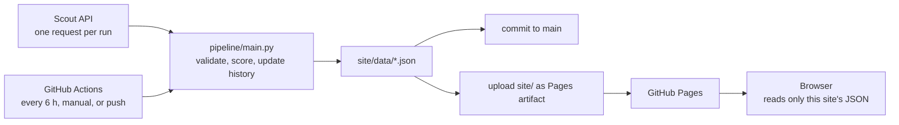

# Follow-Up Priority Board

A static web page that ranks the unconfirmed near-Earth object (NEO) candidates currently listed by NASA/JPL's Scout system by an illustrative "follow-up priority": how much each one seems to need more observations before its position becomes too uncertain to recover. It is a demo of transparent, tunable triage logic. It is not an official method and not a replacement for real tools.

> **Screenshot:** _TODO: add a screenshot here (for example `docs/screenshot.png`)._

**Live site:** `<LIVE_URL>` _(TODO: add the GitHub Pages link once it is published)_

The page has a sky map of where the objects are (dot size shows priority), five weight sliders that re-rank everything live (the panel can be collapsed to bring the table higher, and it starts collapsed on phones, as does the explainer), a chart of how the priorities are distributed, and a sortable table where any row opens to show exactly how its score was built. Picking a dot on the map opens and scrolls to that object's row. There are no AI or LLM calls anywhere in the app.

## How the score works

Python turns each Scout field into a number between 0 and 1 (a "factor"). The browser only takes a weighted average of those factors, so the sliders re-rank live and the factor math lives in one place. All thresholds, weights and labels are in [`config/scoring.json`](config/scoring.json).

Two helpers are used below: `clamp01(x)` limits `x` to 0..1, and `lognorm(x, lo, hi) = clamp01((log10(x) − log10(lo)) / (log10(hi) − log10(lo)))`. A value of zero or below is treated as "at or below `lo`" and logged as a warning.

| Factor | What it tries to capture | Formula (0 to 1) | Default weight |
|---|---|---|---|
| **Urgency** | Position uncertainty that is large, or growing fast | `0.7 × lognorm(uncP1, 1, 600) + 0.3 × clamp01(log10(uncP1 / unc))`. If `unc` is missing or 0, only the first term is used (renormalized). | 0.30 |
| **Sparse** | Few observations and a short observed arc | `0.5 × (1 − clamp01((nObs − 3) / 17)) + 0.5 × (1 − lognorm(arc_hours, 0.5, 72))` | 0.20 |
| **PHA likelihood (Scout)** | Scout's own PHA likelihood score | `phaScore / 100` | 0.20 |
| **Observability** | Bright and far from the Sun. Coarse, not site-specific. | `0.6 × clamp01((24 − Vmag) / 6) + 0.4 × clamp01((elong − 45) / 90)` | 0.15 |
| **Closeness** | A small close-approach distance, in lunar distances (LD) | `1 − lognorm(distance_LD, 0.1, 100)`, where `distance_LD` is `caDist` if Scout gave one, otherwise `moid × 389.17`. The page shows which one was used. | 0.15 |

`uncP1` and `unc` are Scout's plane-of-sky uncertainty one day ahead and now, in arcminutes. `nObs`, `arc`, `Vmag`, `elong`, `caDist` and `moid` are Scout's fields of the same names.

**Gate.** `gate = neoScore / 100`, where `neoScore` is Scout's likelihood that the object is a NEO.

**Priority** (computed in the browser, shown as 0 to 100):

```
priority = gate × Σ(weight_i × factor_i) / Σ(weight_i)      over the factors that are not missing
```

- A missing factor is left out of both sums. It is never filled in with a guess, and the row is flagged "missing data".
- The weights are renormalized, so only their proportions matter. The page shows each slider's effective percentage.
- Each row shows a stacked bar of how many priority points each factor contributed (the segments add up to the priority) and a one-sentence "why ranked here" built from the two largest contributions.
- Scout's own `rating` (its impact-chance category) is shown in the row detail but is **not** used in the score.

**Badges.** These are quick flags, with thresholds in the same config file:

| Badge | Rule |
|---|---|
| Orbit uncertain | `uncP1` > 60 arcmin |
| Few observations | `nObs` < 6 or `arc` < 2 hours |
| Close approach | `caDist` < 5 LD (only when Scout gave a `caDist`) |
| Scout run 24 h+ ago | `lastRun` is more than 24 hours before the fetch. Tooltip: "Scout hasn't recomputed this object in over a day. This may mean no new observations have been reported." (The badge's internal id is still `stale_scout_run`.) |
| New | First seen in the most recent snapshot. Not shown on the very first run, when everything would be new. |

## What I learned from the data

**`lastRun` and the "Scout run 24 h+ ago" badge.** Scout's API documentation lists `lastRun` as a field but does not say what it means. In the one live snapshot I looked at (50 objects, fetched 2026-11-13 02:07 UTC), the ephemeris time `tEphem` was about 8 minutes old for every object, which fits Scout's statement that ephemeris information is updated every 15 minutes. `lastRun` was different: it ranged from under an hour to about 200 hours. 22 of the 50 objects had a `lastRun` more than 24 hours old, and those objects tended to have fewer observations, shorter arcs and much larger uncertainty than the others (medians of 4 vs 11 observations, a 1.9 h vs 12.3 h arc, and 205 vs 0.3 arcmin of uncertainty one day ahead).

My guess, which I have not confirmed in any documentation, is that Scout recomputes an object when new observations come in, so an old `lastRun` might mean no new observations have been reported. The data alone cannot tell me that. That is why the badge is worded as a time rather than as a verdict on the object, and why its tooltip says "may". I kept the 24 hour threshold because `uncP1` looks one day ahead; that is my own reasoning, not something Scout states. This is one snapshot, so treat it as an observation, not a finding.

## Limitations

- **Everything here is unconfirmed.** Scout itself warns that its objects are unconfirmed, that some may not be real, that values such as H, MOID and close-approach distance are very uncertain for short arcs, and that its scores identify interesting objects rather than give rigorous probabilities.
- **The priority is my own heuristic.** The factor formulas, ranges and default weights are my choices. They are not calibrated or validated against real follow-up outcomes.
- **Sky positions are approximate.** Scout gives right ascension to the minute and declination to the degree, and they come from its coarse ephemeris for about the time of the snapshot, so they go out of date as objects move. The map is a plain flat plot laid out like a sky chart, with right ascension increasing to the left (24h on the left, 0h on the right, so east is on the left): it shows no horizon, time of night or visibility, and dots can overlap where objects are close together.
- **It knows nothing about your telescope.** There is no site, time of night, weather or cost model. "Observability" is only a rough brightness and sky-position measure.
- **Snapshots are about every 6 hours.** Objects that are listed only briefly between two snapshots are missed.
- **An object that disappears is "last seen", nothing more.** Scout removes objects both when they are confirmed and when they stay unconfirmed, and this page cannot tell which happened.
- **Scout is the only source.** The page does not use the Minor Planet Center's list directly or any other service.
- **History is short.** Snapshot history is kept for 30 days, and the "New" badge depends on it.
- **Weights are not saved.** The sliders reset when the page is reloaded.
- **Accessibility has only been checked with automated tests.** See [Accessibility](#accessibility).

## Prior art and how this differs

- **[JPL CNEOS Scout](https://cneos.jpl.nasa.gov/scout/intro.html)** monitors the Minor Planet Center's NEO Confirmation Page and publishes orbit-based assessments and likelihood scores for each object. It is this project's only data source. This project does not fit orbits or assess anything itself; it re-ranks numbers that Scout publishes.
- **[NEOfixer](https://neofixer.arizona.edu/faq/how-does-neofixer-assign-priority)** (from the Catalina Sky Survey) assigns each target a priority for follow-up. According to its FAQ, the priority is Importance × Confidence × Benefit × Urgency ÷ Cost, where the Cost is estimated for each subscribing observing site from its instruments, the target's magnitude, the sky brightness, airmass and stellar confusion.

This project differs in being much simpler. It is an additive weighted average with a gate, there is no per-site cost model, every factor and weight is visible and adjustable in the page, and it keeps its own snapshot history. It is a way to explore the idea of triage, not a way to plan real observations. For that, use Scout and NEOfixer.

## Architecture



- **`pipeline/`** is a Python 3.12 script that uses only the standard library. It fetches Scout once, validates and parses the response, computes the factors and badges, updates the history and writes JSON into `site/data/`.
- **`site/`** is plain HTML, CSS and JavaScript modules, with no framework, no build step and no dependencies. The browser applies the weights.
- **The browser never calls Scout.** JPL's fair-use policy says the API may not be embedded in a website, so the page only reads its own JSON files.
- **GitHub Actions** ([`update-and-deploy.yml`](.github/workflows/update-and-deploy.yml)) runs the Python and JavaScript tests, then the pipeline, commits any changed data, and deploys `site/` to GitHub Pages in the same workflow. On a push it only redeploys without fetching.
- **Fair use.** Exactly one request per run, an application-specific `User-Agent` with contact details (from `config/app.json`), a 30 second timeout, and at most two retries (after 10 s and 30 s) on network errors or HTTP 500/503. The expected Scout API version is checked, and a mismatch only logs a warning.
- **If a fetch fails**, `latest.json` and `history.json` are left alone, `status.json` records the failure, and the page says "The last update attempt failed". The workflow still deploys and then fails a final step, so the run shows red.
- **Commit on every run.** Each run changes `generated_at` in `latest.json` and `last_attempt` in `status.json`, so almost every run makes a commit. That is expected. These commits should also count as repository activity, which helps with GitHub's rule that disables scheduled workflows in public repositories after 60 days without activity.

```
.
├── config/
│   ├── app.json              contact, repo URL, expected Scout version
│   └── scoring.json          weights, thresholds, labels (single source of truth)
├── pipeline/                 fetch.py, parse.py, factors.py, history.py, main.py
├── site/
│   ├── index.html, styles.css
│   ├── js/                   app.js, score.js, sky.js, render.js, format.js, *.test.js
│   └── data/                 latest.json, history.json, status.json, scoring.json
├── tests/                    pytest tests and fixtures
├── .github/workflows/update-and-deploy.yml
├── SPEC.md                   the spec this project was built from
└── requirements-dev.txt      pytest (tests only)
```

## The JSON files

The pipeline writes these files with sorted keys and indentation, so changes show up cleanly in Git diffs. Scout sends most numbers as strings and some as `null`; the pipeline converts the numbers and keeps the nulls. All times are UTC in ISO 8601 form with a `Z`.

**`site/data/latest.json`** (one object shown, trimmed):

```json
{
  "schema_version": 1,
  "source": "scout",
  "generated_at": "2026-11-13T02:07:32Z",
  "scout_version": "1.3",
  "scout_count": 50,
  "objects": [
    {
      "objectName": "6LB3E21",
      "raw": { "nObs": 17, "arc": 8.89, "unc": 0.06, "uncP1": 0.37, "neoScore": 2, "caDist": null, "lastRun": "2026-11-12T15:36:00Z", "...": "all 24 Scout fields, parsed" },
      "factors": { "urgency": 0.237, "sparse": 0.2987, "pha": 0.0, "observability": 0.7733, "closeness": 0.0 },
      "closeness_source": "moid",
      "gate": 0.02,
      "badges": [],
      "first_seen": "2026-11-13T02:07:32Z",
      "missing": []
    }
  ]
}
```

- `source` is `"scout"` for a real fetch or `"fixture"` for the saved test file. The page shows a "Demo data from a saved test file" banner for `"fixture"`, and a real run ignores any history or status file whose source is not its own.
- A factor is `null` when all of its inputs are missing. `missing` lists those factors by name (for example `"closeness"`), a factor that lost only one input as `"urgency.unc"`, and a missing `neoScore` as `"gate"`.
- `badges` holds ids such as `orbit_uncertain`, `few_observations`, `close_approach`, `stale_scout_run` and `new`.
- Objects are sorted by name, not by priority. The ranking is done in the browser.

**`site/data/history.json`** keeps a snapshot for each object whenever Scout re-runs it, and drops objects not seen for 30 days:

```json
{
  "schema_version": 1,
  "source": "scout",
  "objects": {
    "6LB3E21": {
      "first_seen": "2026-11-13T02:07:32Z",
      "last_seen": "2026-11-13T02:07:32Z",
      "snapshots": [
        { "t": "2026-11-12T15:36:00Z", "nObs": 17, "arc": 8.89, "unc": 0.06, "uncP1": 0.37, "neoScore": 2 }
      ]
    }
  }
}
```

A snapshot is added only when the pair (object name, `lastRun`) is new. `first_seen` and `last_seen` use the fetch time.

**`site/data/status.json`**: `{ "source", "last_attempt", "last_success", "ok", "consecutive_failures", "message" }`. The page reads it to show whether the last update attempt failed.

**`site/data/scoring.json`** is a copy of `config/scoring.json`, so the browser uses the same weights, labels and phrases as the pipeline.

## Setup

You need a GitHub repository (a fork or your own copy) with GitHub Pages and Actions available.

1. **Set your details.** Edit [`config/app.json`](config/app.json): set `repo_url` to your repository's URL and `contact` to an email address. They go into the `User-Agent` that JPL's fair-use policy asks for. A real fetch refuses to run while either one is still a `<...>` placeholder.
2. **Turn on Pages.** In the repository, go to Settings → Pages and set Source to **GitHub Actions**.
3. **Push to `main`.** The first run is triggered by the push, which only redeploys the site (it skips the Scout fetch).
4. **Fetch real data.** In the Actions tab, open **Update and deploy** and choose **Run workflow** from `main`. After that it runs on its own every 6 hours (at minute 17).

The workflow uses the official `actions/*` actions at their current major versions (checkout v7, setup-python v7, setup-node v7, configure-pages v6, upload-pages-artifact v5, deploy-pages v5), Python 3.12 and Node 26, which was the current LTS when this was written.

**To stop the schedule**, either delete the `schedule:` block in the workflow file (manual runs and push deploys keep working), or go to Actions → Update and deploy → ⋯ → Disable workflow (this stops everything, including deploys on push).

### Running it locally

```bash
python3.12 -m venv .venv
.venv/bin/pip install -r requirements-dev.txt

.venv/bin/pytest -q          # Python tests
node --test site/js          # JavaScript tests

# Demo data from the saved test file (no network). Labeled source "fixture".
.venv/bin/python -m pipeline.main --fixture tests/fixtures/scout_sample.json

# View the page. Serve it; opening index.html directly will not work, because it loads JSON.
python3 -m http.server --directory site 8000     # then open http://localhost:8000
```

To fetch real data locally, run `.venv/bin/python -m pipeline.main`. It makes one request to Scout, so please do not run it in a loop. It needs `repo_url` and `contact` set in `config/app.json`. Either command overwrites `site/data/`.

## Accessibility

I aimed for WCAG 2.1 AA. It was checked with automated keyboard and contrast tests, and **it has not been tested with a screen reader.**

What the automated checks covered, using throwaway scripts that drive headless Chrome and are not part of this repository:

- **Keyboard:** real key presses for the full Tab order (no traps, a logical order, a visible focus indicator on every stop), plus Enter, Space, arrow keys, Home, End and Escape on the buttons, sliders, disclosure panels, chart and sky map. The map is one Tab stop; the arrow keys step through the objects in priority order and Enter opens the object's row. Hovering and clicking on the map were checked with a real mouse in the same test.
- **Contrast:** the computed contrast of every visible text element in both the dark and light themes, plus the focus indicator and the chart and bar colors.
- **Names and structure:** that every control has an accessible name in the browser's accessibility tree, that headings, landmarks and table headers are in place, and that there are no duplicate ids or broken `aria-` references.
- **Layout and motion:** no sideways page scrolling at 320 px wide or at 200% zoom (the table and the chart scroll inside their own boxes at 320 px), and no CSS animation. The one movement is a smooth scroll when you pick an object on the sky map; the code skips it when reduced motion is requested, but my automated checks did not exercise that path.
- **Browsers:** everything was run in Chrome only.

What is not covered: screen readers (NVDA, JAWS, VoiceOver), a manual WCAG audit, and real phones and tablets. Please treat the accessibility as unverified until someone has tested it that way.

Design choices that go with it: semantic HTML (a captioned table, labeled sliders), skip links, an `aria-live` region that announces "Ranking updated" and sorts, `aria-sort` on sortable columns, a text alternative for every bar, dot and chart, a table view of both the chart and the sky map, and no information carried by color alone.

## How this was built

I built this with [Claude Code](https://claude.com/claude-code) from a written spec ([`SPEC.md`](SPEC.md)), working in phases, and I reviewed and tested the result myself.

### Corrections I made to AI output

- TODO: _I'll fill this in myself._

## Credits and disclaimers

- Data: NASA/JPL CNEOS Scout. Credit is text only; no NASA or JPL logos are used.
- Prior art: JPL CNEOS Scout and NEOfixer from the Catalina Sky Survey, described above.
- This project is not affiliated with NASA, JPL, the Minor Planet Center, or the Smithsonian.
- All objects shown are unconfirmed candidates, and some may not be real. The priority is an illustrative heuristic I designed, not an official method.
